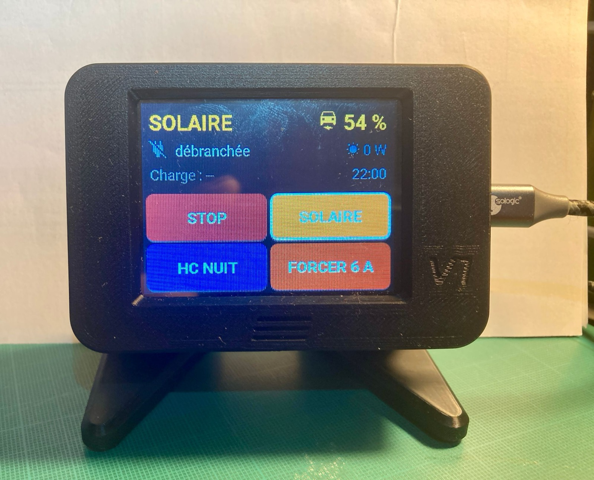
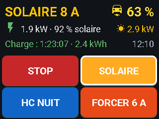
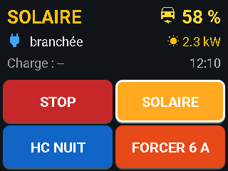
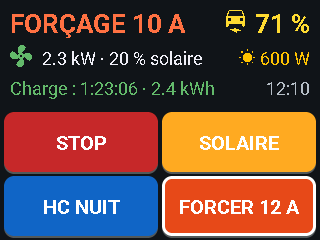
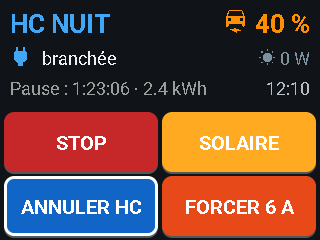
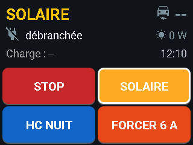
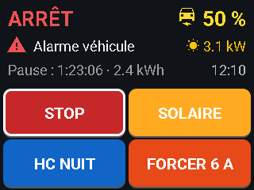

# DomBusEVSE touch screen + solar priority (Home Assistant)

*[Version française](README.fr.md)*

A small **touch screen next to the charging point** to control a
[Creasol DomBusEVSE](https://www.creasol.it/) wallbox through Home Assistant, plus
Home Assistant packages that let the **car and an electric water heater share the solar surplus**
without fighting each other.



Built and used daily with a DomBusEVSE (EVSE1P kit, single phase, 6–13 A), a Hyundai Ioniq PHEV,
APsystems micro-inverters and an MSunPV hot-water router. The screen's interface is in **French**.

## The screen

| | |
|---|---|
| Board | ESP32-2432S028 "CYD" (Cheap Yellow Display), 2-USB version: 2.8" 320×240 ILI9341, XPT2046 resistive touch, RGB LED, about €15 |
| Software | ESPHome + LVGL, Wi-Fi, native Home Assistant API, OTA updates |
| Principle | **No logic in the screen.** It shows Home Assistant states and, when a button is pressed, asks Home Assistant to run a script. The same scripts work from the dashboard. |

| Solar charging | Plugged in, waiting for surplus | Forced at 10 A |
|---|---|---|
|  |  |  |
| **Off-peak scheduled** | **Unplugged** | **Charger alarm** |
|  |  |  |

**Displayed:** mode with the actual current (colour-coded), car battery %, charger state
(pictogram, plus power and solar share while charging), current solar production,
duration and energy of the charging session, time.

**4 buttons, held for 2 seconds** (a short press only shows `MAINTENIR` = "hold"):

| Button | Action |
|---|---|
| **STOP** | Stops charging; the charger returns to Solar mode by itself a few minutes later |
| **SOLAIRE** | Charge from the solar surplus only |
| **HC NUIT** | Schedule charging during off-peak hours (press again to cancel) |
| **FORCER 6 A** | Charge now; each press moves to the next current: 6 → 8 → 10 → 12 → 6 A |

The LED shows the mode colour (green Solar, blue off-peak, orange forced, red stopped).
The screen dims (30 % by day after 5 min, 5 % at night after 1 min) but never switches off;
the first touch only wakes it up.

## Sharing the sun between the car and the water heater

A hot-water router (MSunPV here) sends **all** the surplus to the water heater until its
thermostat cuts off, so a wallbox in Solar mode never starts. When both regulate on the same
grid measurement, they oscillate ("yo-yo": charging stops and restarts every few minutes).

`wallbox_priorite_ballon.yaml` gives priority to the car once the water is warm enough
(threshold `input_number.seuil_temperature_ce`):

- **Start:** water above the threshold, wallbox in Solar, car plugged in and not full,
  solar ≥ 1,800 W for 5 min → charge at 6 A (also when the car starts charging as soon as it is plugged in).
- **Slow regulation:** every minute, +1 A while the water heater still receives more than 400 W, up to 12 A.
- **Fast reduction:** if the house buys from the grid, the current drops at once by the amount bought (within 15 s, never below 6 A), then waits 5 min before rising again.
- **End:** battery full, sustained grid import, or water 3 °C below the threshold → back to normal Solar mode.

The car moves **slowly** and the router **fast**, so the router always gives the water heater exactly what is left.

## Files

```
esphome/ecran-wallbox.yaml          screen configuration (entity IDs in `substitutions:`)
esphome/secrets.yaml.example        copy to secrets.yaml and fill in
homeassistant/packages/
  ecran_wallbox.yaml                scripts called by the 4 buttons
  wallbox_amperes.yaml              forced charging at 6/8/10/12 A (EVMaxCurrent + mode 100%)
  wallbox_solaire_defaut.yaml       Solar as the resting mode (automatic return after a stop)
  wallbox_heures_creuses.yaml       off-peak charging request, start and end
  wallbox_priorite_ballon.yaml      car priority over the water heater, with regulation
  wallbox_puissance_reseau.yaml     sends the grid power to the module (Modbus register 11)
```

## Requirements

- The **Creasol DomBusEVSE Home Assistant configuration** (Modbus), which provides
  `input_select.evmodename`, `input_select.evstatename`, `input_number.evmaxcurrent`,
  `input_button.evmodeset` and the register-write automations.
- These entities, from your own installation (rename them or create template sensors):

| Entity | Meaning |
|---|---|
| `sensor.grid_power` | Grid power in W, **positive when buying**, negative when exporting |
| `sensor.solar_power` | Current solar production (W) |
| `sensor.car_battery_level` | Car battery (%) |
| `binary_sensor.car_plugged_in` | Car plugged in |
| `sensor.evse_charging_power` / `sensor.evse_charging_current` | Actual charging power (W) / current (A) |
| `sensor.evse_solar_share` | Solar share of the charging power (%) |
| `sensor.evse_mode_raw` | Raw mode register of the module (used only to check it is reachable) |
| `sensor.water_heater_temperature` / `sensor.water_heater_power` | Water heater temperature (°C) / power (W), for the priority package only |

## Installation

1. Copy `homeassistant/packages/*.yaml` into your Home Assistant `packages` folder
   (with `homeassistant: packages: !include_dir_named packages` in `configuration.yaml`) and restart.
2. In ESPHome, create `secrets.yaml` from the example, adapt `substitutions:` and flash the CYD by USB once; later updates go over Wi-Fi.
3. In **Settings > Devices & services > ESPHome > the screen > Configure**, tick
   **"Allow the device to perform Home Assistant actions"**, otherwise the buttons do nothing.
4. Adjust the Modbus `hub` / `slave` in `wallbox_puissance_reseau.yaml` and the touch calibration if presses land beside the buttons.

## Licence

MIT. Feedback and improvements welcome.
